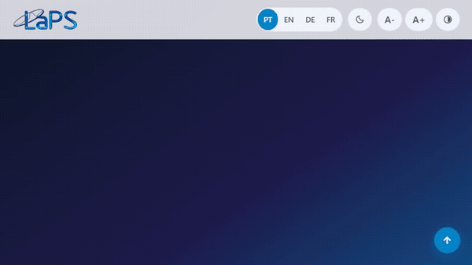

# LaPS — Labor für Signalverarbeitung

🌐 **[Português](README.md)** • **[English](README.en.md)** • **[Deutsch](README.de.md)** • **[Français](README.fr.md)**

---

[](https://github.com/LAPSHub/homepage/actions/workflows/ci.yml)
[](https://github.com/LAPSHub/homepage/actions/workflows/deploy.yml)
[](https://laps.ufpa.br/)
[](https://www.instagram.com/laps_ufpa/)
[](https://www.python.org/)
[](#)
[](LICENSE)

Offizielles institutionelles Portal des **Labors für Signalverarbeitung (LaPS)** der **Bundesuniversität von Pará (UFPA)**. Das Labor forscht in den Bereichen Künstliche Intelligenz, digitale Signal- und Bildverarbeitung, Computer Vision, Biomedizintechnik und Telekommunikation.

Offiziell veröffentlicht unter [laps.ufpa.br](https://laps.ufpa.br/).

---

## 🎬 Plattform-Demonstration (v3.0 LASSE-Standard)



Die Plattform orientiert sich an den Best Practices des **LASSE** für offene Wissenschaft und bietet eine dreifache Teamansicht (**Gitter**, **Liste** und ein **interaktiver 2D-Kollaborationsgraph auf HTML5 Canvas**), Module für **offene Datensätze**, **Open-Source-Software**, **INPI-Patente**, **Nachrichten mit modalem Dialog** und **Fachkurse**.

---

## ⚡ Schnellstart (Lokale Ausführung)

```bash
# Option 1: Python 3
python -m http.server 8000

# Option 2: Node.js (npx serve)
npx serve -l 8000

# Option 3: uv
uv run python -m http.server 8000
```

Öffnen Sie `http://localhost:8000` im Browser.

---

## 🏛️ Architektur & Dynamische Daten

Alle Daten sind in 8 modularen JSON-Dateien im Verzeichnis `data/` strukturiert:

| Datei | Beschreibung |
| :--- | :--- |
| `data/integrantes.json` | Professoren, Doktoranden, Masterstudenten, Bachelor-Forscher und Alumni |
| `data/projetos.json` | F&E-Projekte, Partner und Förderorganisationen |
| `data/producao.json` | Wissenschaftliche Publikationen mit DOIs und BibTeX-Zitaten |
| `data/softwares.json` | Open-Source-Tools der Organisation LAPSHub |
| `data/patentes.json` | Erfindungspatente und INPI-Softwareregistrierungen |
| `data/datasets.json` | Offene wissenschaftliche Datensätze für reproduzierbare Forschung |
| `data/noticias.json` | Institutsnachrichten mit barrierefreiem Lesemodal |
| `data/cursos.json` | Technische Kurse und Workshops |

---

## 🌐 Barrierefreiheit & Benutzereinstellungen (WCAG AAA)

- **Automatische Spracherkennung**: Erkennt die Browsersprache über `navigator.languages` (PT, EN, DE, FR).
- **3-Zustands-Farbthema**: Zyklus `System (Auto)` ➔ `Dunkel` ➔ `Hell` mit Echtzeit-Listener auf OS-Designänderungen.
- **Tastatur- und Lesehilfen**: Skip-Links, Schriftgrößenanpassung (`A-`, `A0` Reset, `A+`), Hochkontrastmodus und `#a11y-announcer`.
- **Offizielles Instagram**: [@laps_ufpa](https://www.instagram.com/laps_ufpa/) nahtlos integriert.

---

## 🧪 Automatisierte Tests

```bash
node scripts/test-suite.mjs
node scripts/verify-playwright.mjs
node scripts/scan-secrets.mjs
```
