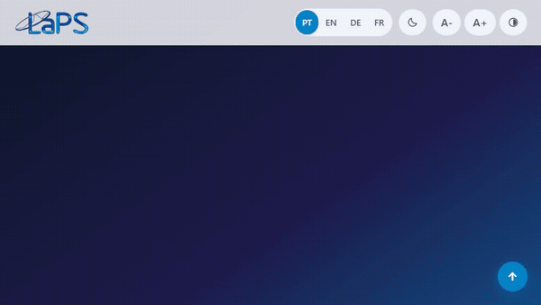

# LaPS — Signal Processing Laboratory

🌐 **[Português](README.md)** • **[English](README.en.md)** • **[Deutsch](README.de.md)** • **[Français](README.fr.md)**

---

[](https://github.com/LAPSHub/homepage/actions/workflows/ci.yml)
[](https://github.com/LAPSHub/homepage/actions/workflows/deploy.yml)
[](https://laps.ufpa.br/)
[](https://www.instagram.com/laps_ufpa/)
[](https://www.python.org/)
[](#)
[](LICENSE)

Official institutional portal of the **Signal Processing Laboratory (LaPS)**, affiliated with the Institute of Technology (ITEC) and the Faculty of Computer Engineering and Telecommunications at the **Federal University of Pará (UFPA)**. The lab conducts cutting-edge research in Artificial Intelligence, Digital Signal & Image Processing, Computer Vision, Bioengineering, and Telecommunications.

Published officially at [laps.ufpa.br](https://laps.ufpa.br/).

---

## 🎬 Platform Demonstration (v3.0 LASSE Standard)



Incorporating open science and scientific dissemination best practices inspired by **LASSE**, the portal provides a triple team view switcher (**Grid**, **List**, and a **2D Canvas Force-Directed Collaboration Network**), as well as modules for **Open Scientific Datasets**, **Open Source Softwares**, **INPI Patents & Software Registrations**, **News with an Accessible Modal Dialog**, and **Technical Training Courses**.

---

## ⚡ Quick Start (Local Execution)

Run a local server to test the asynchronous (`fetch`) rendering of JSON datasets:

```bash
# Option 1: Python 3
python -m http.server 8000

# Option 2: Node.js (npx serve)
npx serve -l 8000

# Option 3: uv
uv run python -m http.server 8000
```

Open `http://localhost:8000` in your browser.

---

## 🏛️ Architecture & Dynamic Data Files

All institutional information is decoupled in 8 structured JSON files in `data/`:

| File | Description | How to Update |
| :--- | :--- | :--- |
| `data/integrantes.json` | Faculty, PhD candidates, Master students, undergraduates, and alumni with academic links | Direct edit. See [docs/data.md](docs/data.md) |
| `data/projetos.json` | R&D projects, industry/hospital partners, and funding agencies | Direct edit. See [docs/data.md](docs/data.md) |
| `data/producao.json` | Peer-reviewed articles indexed by year with DOIs and BibTeX citations | Manual or via `scripts/sync-data.py` |
| `data/softwares.json` | Open-source repositories and tools from the LAPSHub organization | Direct edit. See [docs/data.md](docs/data.md) |
| `data/patentes.json` | Invention patents and INPI software registrations | Direct edit. See [docs/data.md](docs/data.md) |
| `data/datasets.json` | Open signal databases and benchmarks for reproducible research | Direct edit. See [docs/data.md](docs/data.md) |
| `data/noticias.json` | Lab news, calls for papers, and announcements with a modal reader | Direct edit. See [docs/data.md](docs/data.md) |
| `data/cursos.json` | Technical courses and hands-on workshops offered by LaPS | Direct edit. See [docs/data.md](docs/data.md) |

---

## 🌐 Accessibility & User Preferences (WCAG AAA)

- **Browser Locale Auto-Detection**: Automatically queries `navigator.languages` to display the interface in Portuguese, English, German, or French, honoring manual preferences (`?lang=` or toolbar switch).
- **3-State Theme with Real-Time OS Listener**: Cycle `System (Auto)` ➔ `Dark` ➔ `Light`. In System mode, it listens to `window.matchMedia('(prefers-color-scheme: dark)')` to react immediately to device theme changes.
- **Physical & Visual Accessibility**: Keyboard skip-links, font scaling shortcuts (`A-`, `A0` reset, `A+`), high-contrast toggle, and `#a11y-announcer` (`aria-live="polite"`).
- **Official Instagram**: Direct integration with `@laps_ufpa` ([https://www.instagram.com/laps_ufpa/](https://www.instagram.com/laps_ufpa/)) via header icon, contact community card, footer, and Schema.org metadata.

---

## ⚙️ Two-Layer Automation

```
[ORCID v3.0 / Crossref] ---> [Layer 1: sync-data.py] ---> [data/*.json]
                                                                |
[laps.ufpa.br (CTIC)]   <--- [Layer 2: deploy.py]    <--- [GitHub master]
```

### Layer 1: Academic Data Sync (`sync-data.py` / `sync-data.yml`)
- Queries the public ORCID v3.0 API using faculty identifiers.
- Enriches metadata for new publications through the Crossref API, generating standardized citations.
- Merges newly indexed papers into `data/producao.json`.

### Layer 2: Institutional Production Deployment (`deploy.py` / `deploy.yml`)
- Secure connection to `laps.ufpa.br` (`200.239.109.18`) via FTPS/FTP with UFPA VPN connectivity.
- Employs MD5 cache (`.ftp_sync_cache.json`) to transfer only modified files.
- Automatically triggered on push to `master` or manually via `workflow_dispatch`.

---

## 🧪 Automated Testing & Quality Audit

```bash
# Structural schema, i18n, and integrity check (137 assertions):
node scripts/test-suite.mjs

# Dynamic Playwright responsive verification (33 assertions):
node scripts/verify-playwright.mjs

# Credential and security scan:
node scripts/scan-secrets.mjs
```

---

## 👥 Community & Contact

Developed and maintained by the research faculty, staff, and students of **Signal Processing Laboratory (LaPS/UFPA)** and the **LAPSHub** community.

- **Website**: [laps.ufpa.br](https://laps.ufpa.br/)
- **Instagram**: [@laps_ufpa](https://www.instagram.com/laps_ufpa/)
- **GitHub**: [github.com/LAPSHub](https://github.com/LAPSHub)
- **E-mail**: [laps@ufpa.br](mailto:laps@ufpa.br)
