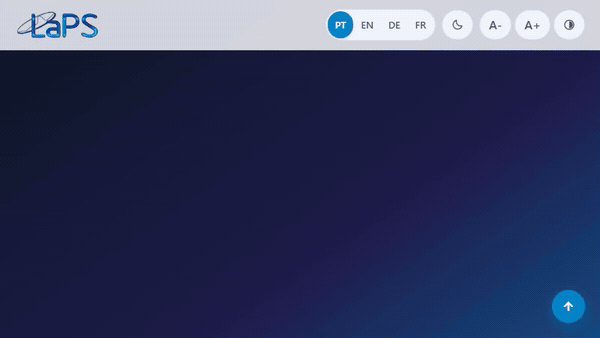

# LaPS — Laboratoire de Traitement du Signal

🌐 **[Português](README.md)** • **[English](README.en.md)** • **[Deutsch](README.de.md)** • **[Français](README.fr.md)**

---

[](https://github.com/LAPSHub/homepage/actions/workflows/ci.yml)
[](https://github.com/LAPSHub/homepage/actions/workflows/deploy.yml)
[](https://laps.ufpa.br/)
[](https://www.instagram.com/laps_ufpa/)
[](https://www.python.org/)
[](#)
[](LICENSE)

Portail institutionnel officiel du **Laboratoire de Traitement du Signal (LaPS)** de l'**Université Fédérale du Pará (UFPA)**. Le laboratoire mène des recherches en Intelligence Artificielle, Traitement du Signal et des Images, Vision par Ordinateur, Bioingénierie et Télécommunications.

Publié officiellement sur [laps.ufpa.br](https://laps.ufpa.br/).

---

## 🎬 Démonstration de la Plateforme (v3.0 Norme LASSE)



La plateforme intègre les meilleures pratiques de science ouverte inspirées du **LASSE**, offrant un sélecteur de vue d'équipe triple (**Grille**, **Liste** et **Graphe de Collaboration Canvas 2D Force-Directed**), ainsi que des modules pour les **Jeux de Données Ouverts**, les **Logiciels Open Source**, les **Brevets INPI**, les **Actualités avec Dialogue Modal** et les **Formations Techniques**.

---

## ⚡ Démarrage Rapide (Exécution Locale)

```bash
# Option 1: Python 3
python -m http.server 8000

# Option 2: Node.js (npx serve)
npx serve -l 8000

# Option 3: uv
uv run python -m http.server 8000
```

Ouvrez `http://localhost:8000` dans votre navigateur.

---

## 🏛️ Architecture & Données Dynamiques

Toutes les informations sont découplées dans 8 fichiers JSON structurés dans `data/` :

| Fichier | Description |
| :--- | :--- |
| `data/integrantes.json` | Professeurs, doctorants, étudiants de master, chercheurs de licence et anciens élèves |
| `data/projetos.json` | Projets de R&D, partenaires et organismes de financement |
| `data/producao.json` | Articles scientifiques répertoriés avec DOIs et citations BibTeX |
| `data/softwares.json` | Outils open source de l'organisation LAPSHub |
| `data/patentes.json` | Brevets d'invention et dépôts de logiciels à l'INPI |
| `data/datasets.json` | Jeux de données scientifiques ouverts pour la recherche reproductible |
| `data/noticias.json` | Actualités du laboratoire avec lecteur modal accessible |
| `data/cursos.json` | Formations et ateliers techniques |

---

## 🌐 Accessibilité & Préférences Utilisateur (WCAG AAA)

- **Détection Automatique de la Langue** : Détection via `navigator.languages` (PT, EN, DE, FR).
- **Thème à 3 États** : Cycle `Système (Auto)` ➔ `Sombre` ➔ `Clair` avec écouteur en temps réel sur les changements de mode de l'OS.
- **Accessibilité Visuelle et Motrice** : Liens d'évitement au clavier, redimensionnement de police (`A-`, `A0` réinitialisation, `A+`), contraste élevé et `#a11y-announcer`.
- **Instagram Officiel** : [@laps_ufpa](https://www.instagram.com/laps_ufpa/) intégré.

---

## 🧪 Tests Automatisés

```bash
node scripts/test-suite.mjs
node scripts/verify-playwright.mjs
node scripts/scan-secrets.mjs
```
