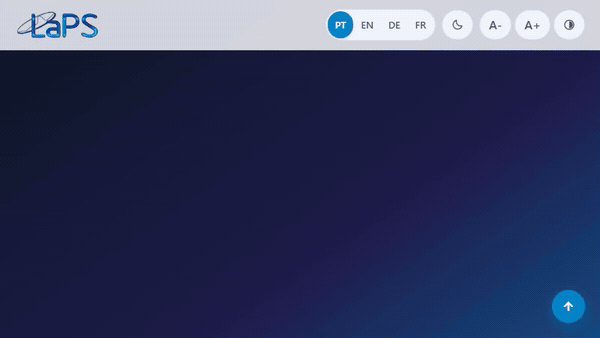

# LaPS — Laboratório de Processamento de Sinais

🌐 **[Português](README.md)** • **[English](README.en.md)** • **[Deutsch](README.de.md)** • **[Français](README.fr.md)**

---

[](https://github.com/LAPSHub/homepage/actions/workflows/ci.yml)
[](https://github.com/LAPSHub/homepage/actions/workflows/deploy.yml)
[](https://laps.ufpa.br/)
[](https://www.instagram.com/laps_ufpa/)
[](https://www.python.org/)
[](#)
[](LICENSE)

Portal institucional oficial do **Laboratório de Processamento de Sinais (LaPS)**, vinculado ao Instituto de Tecnologia (ITEC) e à Faculdade de Engenharia da Computação e Telecomunicações da **Universidade Federal do Pará (UFPA)**. O laboratório atua em inteligência artificial, processamento digital de sinais e imagens, visão computacional, bioengenharia e sistemas de telecomunicações.

Publicado oficialmente em [laps.ufpa.br](https://laps.ufpa.br/).

---

## 🎬 Demonstração da Plataforma



A plataforma incorpora as melhores práticas de transparência ativa e divulgação científica inspiradas no **LASSE**, oferecendo visualizador tríplice de equipe (**Grade**, **Lista** e **Grafo de Colaboração em Canvas 2D**), módulos de **Datasets Abertos**, **Softwares Livres**, **Patentes INPI**, **Notícias com Leitor Modal** e **Cursos de Capacitação**.

---

## ⚡ Início Rápido (Execução Local)

Execute um servidor local para testar a renderização assíncrona (`fetch`) dos dados JSON:

```bash
# Opção 1: Python 3
python -m http.server 8000

# Opção 2: Node.js (npx serve)
npx serve -l 8000

# Opção 3: uv
uv run python -m http.server 8000
```

Abra `http://localhost:8000` no seu navegador.

---

## 🏛️ Arquitetura e Dados Dinâmicos

Os dados do laboratório estão centralizados em 8 arquivos JSON independentes do código HTML:

| Arquivo | Descrição | Como Atualizar |
| :--- | :--- | :--- |
| `data/integrantes.json` | Docentes, doutorandos, mestrandos, graduandos e egressos com links acadêmicos | Edição do JSON. Ver [docs/data.md](docs/data.md) |
| `data/projetos.json` | Projetos de pesquisa e desenvolvimento, parceiros e fomentos | Edição do JSON. Ver [docs/data.md](docs/data.md) |
| `data/producao.json` | Produção científica indexada por ano com DOIs e citações BibTeX | Manual ou via `scripts/sync-data.py` |
| `data/softwares.json` | Softwares e ferramentas open source da organização LAPSHub | Edição do JSON. Ver [docs/data.md](docs/data.md) |
| `data/patentes.json` | Patentes de invenção e registros de programas de computador no INPI | Edição do JSON. Ver [docs/data.md](docs/data.md) |
| `data/datasets.json` | Bancos de sinais e datasets abertos para ciência reprodutível | Edição do JSON. Ver [docs/data.md](docs/data.md) |
| `data/noticias.json` | Notícias, editais e acontecimentos do laboratório com leitor modal | Edição do JSON. Ver [docs/data.md](docs/data.md) |
| `data/cursos.json` | Treinamentos, workshops e oficinas oferecidos pelo LaPS | Edição do JSON. Ver [docs/data.md](docs/data.md) |

---

## 🌐 Recursos de Acessibilidade & Preferências do Usuário (WCAG AAA)

- **Auto-detecção de Idioma do Navegador**: O site lê automaticamente `navigator.languages` e ajusta a interface entre Português, Inglês, Alemão e Francês, preservando escolhas manuais (`?lang=` ou seletor).
- **Tema 3-State com Listener do Dispositivo**: Ciclo `Sistema (Auto)` ➔ `Escuro` ➔ `Claro`. No modo Sistema, o tema responde instantaneamente a mudanças no modo escuro/claro do sistema operacional via `window.matchMedia`.
- **Acessibilidade Motora e Visual**: Skip-links para teclado, atalhos de zoom de texto (`A-`, `A0` reset, `A+`), modo de alto contraste e região viva `#a11y-announcer` (`aria-live="polite"`).
- **Instagram Oficial**: Conectado diretamente em `@laps_ufpa` ([https://www.instagram.com/laps_ufpa/](https://www.instagram.com/laps_ufpa/)) com card comunitário no Contato e ícone no Cabeçalho e Rodapé.

---

## ⚙️ Automação em Duas Camadas

O repositório adota um fluxo desacoplado em duas camadas para manter o site e os dados sempre sincronizados:

```
[ORCID v3.0 / Crossref] ---> [Camada 1: sync-data.py] ---> [data/*.json]
                                                                 |
[laps.ufpa.br (CTIC)]   <--- [Camada 2: deploy.py]    <--- [GitHub master]
```

### Camada 1: Sincronização Acadêmica (`sync-data.py` / `sync-data.yml`)
- Consulta a API pública do ORCID v3.0 a partir dos identificadores dos docentes.
- Enriquece os metadados dos artigos novos via Crossref API gerando citações padronizadas.
- Mescla novos artigos em `data/producao.json` sem sobrescrever dados existentes.
- Executada semanalmente via GitHub Actions ou manualmente:
  ```bash
  python scripts/sync-data.py
  ```

### Camada 2: Publicação Institucional UFPA (`deploy.py` / `deploy.yml`)
- Conecta com o servidor `laps.ufpa.br` (`200.239.109.18`) via FTPS/FTP com suporte a VPN institucional.
- Utiliza cache MD5 (`.ftp_sync_cache.json`) para transmitir apenas arquivos modificados.
- Executada automaticamente em pushes na branch `master` ou via acionamento manual (`workflow_dispatch`).

---

## 🧪 Testes Automatizados e Auditoria de Qualidade

A suíte de validação do Gauntlet Loop garante conformidade rigorosa:

```bash
# Validação estrutural de schemas, i18n e integridade (137 testes):
node scripts/test-suite.mjs

# Verificação E2E dinâmica e responsiva via Playwright (33 testes):
node scripts/verify-playwright.mjs

# Varredura de credenciais e segurança de segredos:
node scripts/scan-secrets.mjs
```

---

## 👥 Contribuição e Comunidade

Desenvolvido e mantido pela equipe e alunos do **Laboratório de Processamento de Sinais (LaPS/UFPA)** e comunidade **LAPSHub**.

- **Website**: [laps.ufpa.br](https://laps.ufpa.br/)
- **Instagram**: [@laps_ufpa](https://www.instagram.com/laps_ufpa/)
- **GitHub**: [github.com/LAPSHub](https://github.com/LAPSHub)
- **E-mail**: [laps@ufpa.br](mailto:laps@ufpa.br)
- **Localização**: Altos do anexo do LEEC, Sala 31 — Campus Guamá, UFPA — Belém, PA, Brasil
